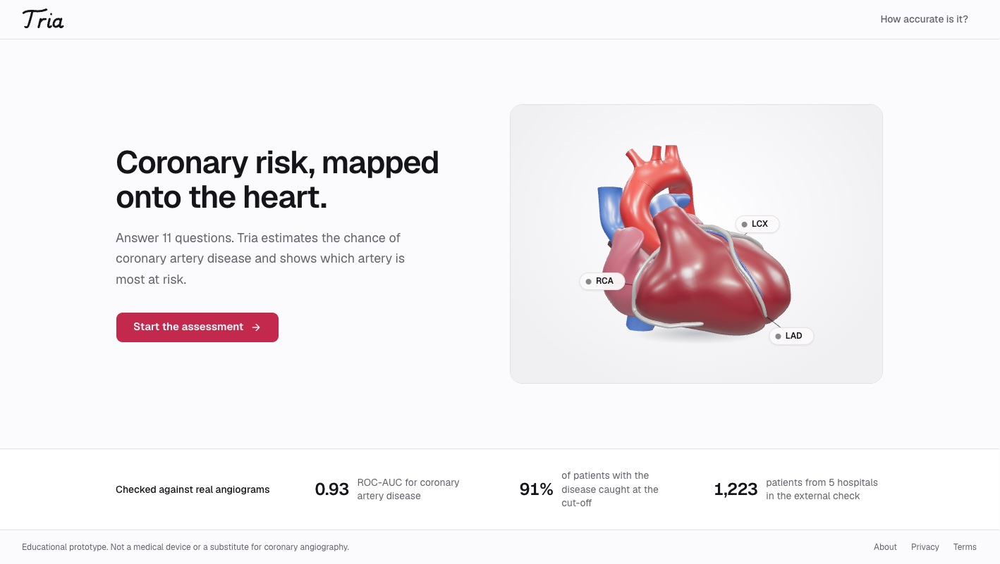

# CardioVision 3D

**Predicts coronary artery disease (CAD) and the stenosis risk of each main coronary artery (LAD, LCX, RCA) from routine clinical data, then maps the risk onto an interactive 3D heart.**

Built for the **Multimodal AI Hackathon 2026, Track A: Cardiovascular Risk Visualization & Prediction**.

> ⚠ **Educational decision-support prototype only.** Not a medical device and not a substitute for coronary angiography or formal diagnostic imaging.



## What it does

- **Predicts** overall CAD (≥50% narrowing in any coronary artery) and stenosis of the **LAD**, **LCX** and **RCA** from 55 demographic, symptom, ECG, echocardiography and laboratory inputs.
- **Visualises** the result on a realistic 3D heart (Three.js, runs in any modern browser without a GPU):
  - each coronary artery runs in its fat groove and is coloured green → ochre → red by its predicted risk. Ochre sits exactly at that artery's own decision cut-off, and the colour reaches full green 30 points below it and full red 30 points above it;
  - click an artery, its label, or its row in the results, and the camera turns to it, highlights the heart muscle it supplies, and the explanation switches to that artery;
  - the **Risk map** toggle colours every territory by its artery's risk;
  - there is an optional translucent torso and ribs for context, and the heart beats at the patient's pulse rate (off when the system asks for reduced motion).
- **Reads like a journal figure:** the heart is Figure 1A, panel B plots CAD and the three arteries on one shared 0 to 100% axis with each model's cut-off marked, panel C is the SHAP forest plot, Table 1 holds the editable patient values and Table 2 the validation results. Works on desktop, tablet (patient table in a slide-over drawer) and phone.
- **Explains** every prediction with **SHAP** values: which measurements pushed the risk up or down, and by how much. It also shows the "points" behind the published CAD Consortium risk score.
- **Updates in real time** as you edit any value, and warns when an input is outside the range seen in training.

## Results (honest, leakage-free validation)

Stratified 5-fold cross-validation repeated 10 times. Every data-driven step is fitted **inside the training folds only**: the forest, the Platt calibrator, the decision threshold and the vessel models. 95% CIs are DeLong intervals averaged over the repeats.

| Target | ROC-AUC (95% CI) | Brier | Calibration slope |
|---|---|---|---|
| Overall CAD | **0.932** (0.900–0.964) | 0.086 | 0.95 |
| LAD | **0.857** (0.814–0.901) | 0.143 | 1.15 |
| LCX | **0.750** (0.696–0.804) | 0.195 | 0.94 |
| RCA | **0.724** (0.668–0.780) | 0.198 | 1.00 |

- **Overall CAD at the pre-specified rule-out cut-off:** sensitivity 0.91, specificity 0.81, PPV 0.92, NPV 0.78.
- **Improvement over our first model:** evaluated on the same splits, AUC rose on all four targets (+0.012 to +0.021). Calibration slopes also improved, from 1.3–2.2 (probabilities too timid) to about 1.0.
- **Why the arteries score lower:** the dataset records ECG and wall-motion findings only as present/absent. It never says *which* leads or heart regions are affected, and that location information is what clinicians use to tell LCX from RCA disease.

All numbers come from `python evaluate.py`, which saves them to `reports/evaluation_v2.json`.

## External validation: five hospitals, four countries

Is the model tied to one hospital? To test this we added the **UCI Heart Disease** dataset: 920 real patients from Cleveland (USA), Budapest (Hungary), Zurich and Basel (Switzerland) and Long Beach (USA). They had coronary angiography with the same ≥50% narrowing rule. With Tehran that gives **1,223 patients from 5 hospitals**.

Only 7 inputs exist in both datasets (age, sex, chest pain type, resting blood pressure, cholesterol, fasting blood sugar > 120, resting ECG), so this is a separate **basic-input CAD model**. The app's predictions still come from the full 55-input model.

**Protocol, written down before any result:** train on 4 hospitals, test on the 5th, for all 5 ("leave one hospital out"). Choose the model with the highest mean held-out AUC; within 0.01, choose the simpler one. Missing values are filled with medians fitted on the training hospitals only, and **no missing-value indicators** are used, because missingness reveals the hospital (Switzerland recorded no cholesterol at all; its "0" values were recoded as missing).

| Held-out hospital | Patients | CAD | Logistic regression | Random forest | Gradient boosting |
|---|---|---|---|---|---|
| Tehran, Iran | 303 | 71% | **0.77** (0.70-0.83) | 0.75 | 0.75 |
| Cleveland, USA | 303 | 46% | **0.78** (0.73-0.83) | 0.77 | 0.76 |
| Budapest, Hungary | 294 | 36% | **0.83** (0.78-0.88) | 0.82 | 0.82 |
| Zurich and Basel, Switzerland | 123 | 94% | **0.78** (0.56-0.94) | 0.70 | 0.72 |
| Long Beach, USA | 200 | 75% | **0.67** (0.59-0.76) | 0.64 | 0.64 |
| **Mean** | 1,223 | | **0.77** | 0.73 | 0.74 |

ROC-AUC on the held-out hospital, with 95% bootstrap intervals for the chosen model. What we learned:

1. **The basic model works at hospitals it never saw:** mean AUC 0.77 (0.67 to 0.83). The full Tehran model's 0.93 shows what the echocardiography and laboratory inputs add.
2. **Simpler models travel better.** Logistic regression beat both tree models at every hospital, although the random forest wins inside Tehran.
3. **Variety beats volume.** Trained on Tehran's 303 patients, the model scores 0.59 to 0.73 at the other hospitals. Trained on **303 patients drawn from the other four hospitals** it scores 0.67 to 0.83, almost as well as with all ~1,000 (mean of 20 draws, SD 0.01 to 0.03):

   | Test hospital | Tehran only (303) | 303 from 4 hospitals | All other hospitals (~1,000) |
   |---|---|---|---|
   | Cleveland | 0.73 | 0.77 | 0.78 |
   | Budapest | 0.71 | 0.83 | 0.83 |
   | Long Beach | 0.61 | 0.67 | 0.67 |
   | Zurich and Basel | 0.59 | 0.77 | 0.78 |

4. **Percentages need local recalibration.** Ranking holds across hospitals, but average predicted risk does not: 35% predicted vs 71% actual for Tehran, 48% vs 36% for Budapest. Each hospital refers a different mix of patients, so a new site should recalibrate (as the full model does with Platt scaling) before trusting the percentages.

Reproduce with `python external_validation.py` (under a minute; downloads UCI #45 into `data/raw/` if missing), which writes `reports/external_validation.json`. Table 2 in the app shows the same results.

## How the model works

```
55 clinical inputs
  → label-free cleaning (drop 4 near-empty columns and 2 exact duplicates: Weight, Obesity)
  → + 7 features from fixed published formulas (no fitting, so no leakage):
      CAD Consortium clinical score (Genders et al., BMJ 2012), CKD-EPI 2021 eGFR,
      neutrophil-to-lymphocyte ratio, ischaemic ECG count, EF < 50%, any wall-motion abnormality,
      LV damage index = max(0, 60 − EF) × abnormal regions
  → P(CAD)    = Platt-calibrated random forest
  → P(vessel) = P(CAD) × Platt-calibrated random forest trained on CAD patients only
```

- **Two-step vessel model.** A blocked artery *means* CAD, so an artery must never look riskier than CAD itself. With independent models, that happened for 19.8% of patients; the two-step design removes it (0%) at a cost of 0.006 mean vessel AUC.
- **Pre-registered decisions.** Candidate models, the selection rule, the threshold rules and the data-cleaning rules were written down before any experiment (`notebooks/`, `preregistration.json` in the Colab run).
- **Label noise.** One patient is labelled LAD-stenotic but CAD-negative. We keep the label as recorded; relabelling or excluding the patient changes the CAD AUC by less than 0.01.

## Run it locally

Prerequisites: Python 3.11+ (tested on 3.13).

```bash
pip install -r requirements.txt
python train.py                       # about 20 s: builds models/ and data/processed/
python -m uvicorn app.main:app --port 8000
```

Then open http://localhost:8000.

To reproduce the validation numbers (about 10–30 minutes):

```bash
python evaluate.py               # internal validation (Tehran)
python external_validation.py    # five-hospital check, under a minute
python train.py                  # copies both reports into models/metadata.json
```

With Docker, which is also how the Hugging Face Space runs:

```bash
docker build -t cardiovision .
docker run -p 7860:7860 cardiovision
```

## API

| Method | Path | Returns |
|---|---|---|
| GET | `/api/meta` | Form layout, thresholds, validation metrics |
| GET | `/api/patients/{index}` | Inputs and true labels of a dataset patient (for demos) |
| POST | `/api/predict` | `{"inputs": {...}}` → probabilities, SHAP explanations, CAD Consortium breakdown, warnings |

## Project structure

```
app/pipeline.py    shared preprocessing + engineered features (used by training AND the server)
app/features.py    labels, units and form layout for the inputs
app/main.py        FastAPI server and prediction API
train.py           trains and saves the final models (models/)
evaluate.py        repeated nested cross-validation → reports/evaluation_v2.json
external_validation.py  leave-one-hospital-out check on 5 hospitals → reports/external_validation.json
static/            web app: index.html, css/, js/heart.js (3D scene), js/app.js (dashboard), logo.svg
data/raw/          the original dataset zips (UCI #411 Tehran, UCI #45 four hospitals)
DESIGN.md          the design system: colours, type, layout and the rules behind them
PRODUCT.md         who the app is for and the product principles the design follows
```

## Data and credits

- **Dataset:** Extension of Z-Alizadeh Sani dataset, UCI Machine Learning Repository #411 (CC BY 4.0). It covers 303 patients who underwent coronary angiography at Shaheed Rajaei Cardiovascular Center, Tehran. Alizadehsani et al.
- **External validation dataset:** Heart Disease, UCI Machine Learning Repository #45 (CC BY 4.0): Cleveland Clinic Foundation (R. Detrano), Hungarian Institute of Cardiology, Budapest (A. Janosi), University Hospitals Zurich and Basel (W. Steinbrunn, M. Pfisterer), V.A. Medical Center, Long Beach (R. Detrano).
- **CAD Consortium clinical model:** Genders T.S.S. et al., *BMJ* 2012;344:e3485.
- **eGFR:** CKD-EPI 2021 creatinine equation, Inker L.A. et al., *NEJM* 2021.
- **Libraries:** scikit-learn, SHAP, FastAPI, Three.js.
- **Design assets:** Public Sans typeface (SIL Open Font License), Phosphor icons (MIT).

## Limitations

- **The full model is trained on one centre:** 303 patients from Tehran, all referred for angiography (71% had CAD). Predictions apply to similar high-risk patients, not to screening the general population.
- **External validation covers the basic inputs only.** A 7-input model holds up across five hospitals in four countries (mean AUC 0.77), but the other hospitals did not record echocardiography or the laboratory panel, so the full 55-input model cannot be tested outside Tehran, and the per-artery models cannot be tested anywhere else: no public dataset records which artery is narrowed.
- **Percentages shift between hospitals.** Average predicted risk differs from the observed rate by up to 37 points across sites, so a new hospital should recalibrate before relying on the percentages.
- **Older external data:** the UCI hospitals collected their patients in the 1980s; Tehran's cholesterol is a Friedewald estimate (LDL + HDL + TG/5).
- **Vessel predictions reflect how extensive the disease is,** not its exact location: the inputs contain no ECG-lead or wall-segment information.
- **The 3D heart is procedurally generated.** It is an illustrative anatomical model, not patient-specific imaging.

## AI assistance

This project was developed with the help of an AI coding assistant, **Claude Code (Claude by Anthropic)**, used for research, code generation and review. All modelling decisions were pre-registered and validated as described above.

The web interface was designed with Claude Code using three open-source design skills:

- **[Impeccable](https://impeccable.style/)** (`pbakaus/impeccable`): product brief, design direction, an independent finish review of the built interface, and the design record in `DESIGN.md`;
- **[UI UX Pro Max](https://github.com/nextlevelbuilder/ui-ux-pro-max-skill)**: healthcare design and accessibility guidance (contrast, keyboard focus, reduced motion, touch targets);
- **[Taste Skill](https://www.tasteskill.dev/)** (`Leonxlnx/taste-skill`): anti-template rules for typography, colour and copy.

The design direction, the logo choice and every product decision were reviewed and chosen by the author.
